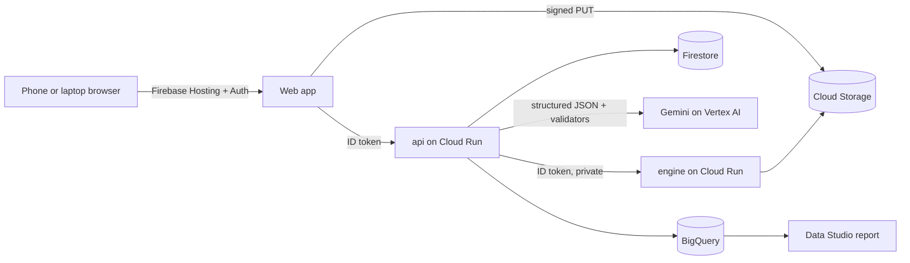

# Willow

**The proof engine for skincare.** Willow tells a person whether a product *measurably* changed their skin, beyond the normal photo-to-photo noise of their own camera, and tells multi-brand retailers which products produce measured results for which customers, not just sales.

Built for the **Google Cloud AI Builder Cup 2026** (Hack2skill), theme **Retail & Commerce: Intelligent Customer and Business Experiences**, Oct 12 to 18, 2026.

> Cosmetic appearance tracking. Not a medical device and not a diagnosis.

## Try it
- **Judges: https://willow-511508.web.app/judge** (about four minutes, no sign-in). You get a guest account of your own; every stop runs live: the measurement engine on Cloud Run, Gemini on Vertex AI, Firestore and BigQuery. A side panel shows the live status of each service.
- App: https://willow-511508.web.app

## The problem
People spend weeks on a serum and still cannot tell whether it worked: phone photos change with light, angle and the camera's own processing, so "looks better" is mostly noise. Retailers only see purchases and returns, never outcomes, so recommendations reward marketing rather than results.

## What Willow does
1. **Measure.** Standardized photos (a RAW DNG with a white reference or colour card, or a quick browser selfie marked "trend only") go to a Python computer-vision engine that corrects colour and measures cosmetic parameters (today: skin tone ITA° and redness a* on a marked forearm square; face metrics are in progress).
2. **Prove.** The first session of each place is the person's **baseline**. Its five photos, each set up from scratch, give a personal **noise band** (minimum detectable change at 95%). A later reading is called a *real change* only when it leaves that band. A treated-versus-untreated forearm test separates a product's effect from light and time of day.
3. **Explain and advise.** Gemini explains results in plain words, reads ingredient labels, checks routines for clashing actives and recommends products from a facts-only catalog with links to several stores. **Gemini never produces a measurement**, and every number it writes is checked against the data.
4. **Learn.** Anonymized outcomes (opt-in) flow to BigQuery. Retailers see which products produced measured change for which goals, skin-tone bands and price tiers, and can ask questions in plain words. The demo cohort is synthetic and labelled everywhere.

## How we use Google Cloud
| Service | What it does in Willow |
|---|---|
| **Firebase Hosting** | Serves the React web app |
| **Firebase Authentication** | Google sign-in and anonymous guest accounts (each judge gets one) |
| **Cloud Run** (x2) | `willow-api` (FastAPI: sessions, signed uploads, Gemini, catalog, retailer insights) and `willow-engine` (private; RAW decoding and measurement, called with an ID token) |
| **Firestore** | Sessions, baselines, routines, consent, usage limits |
| **Cloud Storage** | Photos via V4 signed URLs (deleted after 30 days), engine outputs, hosted judge samples |
| **Gemini on Vertex AI** (`gemini-3.8-flash`) | Six jobs, all structured JSON validated before use (below) |
| **BigQuery** | Outcome tables for the retailer view and the "Ask this data" assistant |
| **Data Studio** (formerly Looker Studio) | [A shareable retailer report](https://datastudio.google.com/reporting/5147af6b-c268-470a-a420-2277dfcfe7df) on the same suppressed aggregates (`api/scripts/publish_looker.py`) |



## Gemini: six jobs, never a measurement
| Job | Where | How it is kept honest |
|---|---|---|
| Explain a result | Report | Input rounded to what the screen shows; any number not in the input rejects the answer; fixed template if it fails twice |
| Read an ingredient label | Routine, "Scan the label" | Vision to structured JSON; matched to the catalog when possible; the person confirms before saving |
| Check a routine | Routine | A rule table in code is final; Gemini may only add findings, marked AI-suggested, never remove one |
| Shopping advisor | Advisor | Function calling with three tools (`search_catalog`, `compare_products`, `check_routine`); products only from tool results; every number checked; the steps and checks are shown under each answer |
| Answer a retailer's question | Retailer, "Ask this data" | Sees aggregates only (groups under 10 hidden); answer, chart labels and chart values must exist in the data |
| Label regions the engine finds | Report (waits for the engine's face crops) | Two runs must agree; marked AI-suggested |

Shared rules: cosmetic language only, no disease names, never ranks skin tone ("lighter is better" is banned wording), daily caps per person and across everyone.

## Repo layout
| Path | What |
|---|---|
| `engine/` | Python image pipeline and FastAPI service (Cloud Run) |
| `api/` | FastAPI: sessions, uploads, Gemini features, catalog, retailer insights, judge mode (Cloud Run) |
| `web/` | React + Vite + TypeScript + Tailwind (Firebase Hosting) |
| `infra/` | GCP and Firebase setup, deploy commands |
| `schemas/`, `fixtures/` | The engine contract (JSON Schema) and sample output |
| `docs/` | Product, decisions, contract, metrics, capture protocol, Gemini spec, retailer insights, demo and submission plans |

## Run it locally
Prerequisites: Python 3.12 with `uv`, Node 20+, `gcloud` with Application Default Credentials for the project.

```bash
cd api && uv sync && ENGINE_MODE=fixture AUTH_MODE=dev uv run uvicorn app.main:app --port 8080
```

```bash
cd web && npm ci && VITE_AUTH_MODE=dev VITE_DEV_UID=local npm run dev
```

`ENGINE_MODE=fixture` answers from the contract fixture (labelled as a sample, never as a measurement). For a full end-to-end run against the real engine, storage, Firestore, Gemini and BigQuery, see `docs/LOCAL_DEV.md` and `api/scripts/e2e.py` (27 checks).

Tests: `cd api && uv run pytest` and `cd web && npm run lint`.

## Data and privacy
- Photos live only in a private Cloud Storage bucket and are deleted after 30 days; nothing is used to train models. "Delete my data" removes everything in minutes.
- Retail insights include only people who opted in, hashed, aggregated, with groups under 10 people hidden. The demo cohort of 500 people is synthetic (`api/app/cohort.py`, seed 7) and labelled on every screen.
- No images, RAW files, keys or `.env` files are committed. Services use service accounts and Application Default Credentials.

## Status and limits
Measured today: forearm skin tone and redness, calibrated (RAW + white reference) and quick selfie (trend only). Face and close-up photos are stored and will be measured when the engine's face pipeline lands; `api/scripts/remeasure.py` then measures the saved photos so the first one becomes the baseline. Willow cannot assess moles or skin conditions; for a changing mole, see a dermatologist.

## Attribution
Engine: NumPy, rawpy / LibRaw, colour-science, scikit-image, Pillow, pillow-heif, FastAPI. api: FastAPI, Pydantic, google-genai, Firebase Admin, Google Cloud client libraries, httpx, jsonschema. Web: React, React Router, Vite, Tailwind CSS, Firebase JS SDK, Motion, Lucide, Sonner, Vaul, Recharts, NumberFlow, Atkinson Hyperlegible (Braille Institute). Product images are linked from brand or retailer pages with a credit, never re-hosted.

Team: Niwin Kumar (api, web, infra, Gemini, data) and Harshini (measurement engine). MIT licence.
