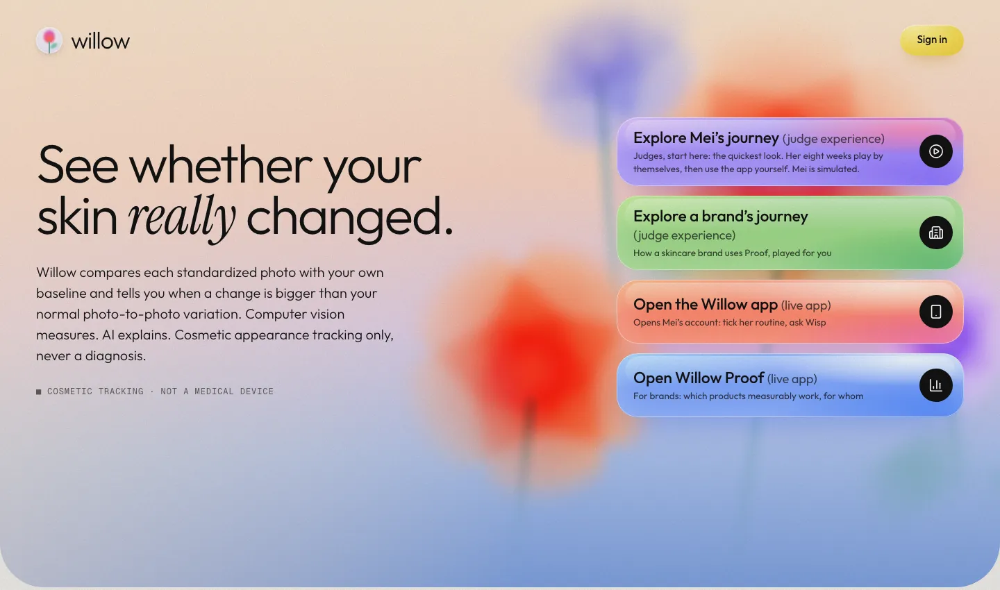
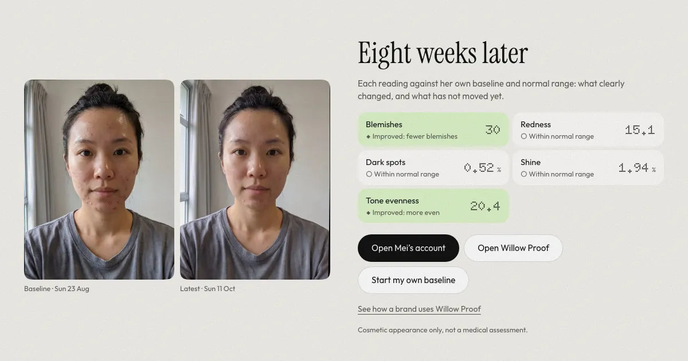
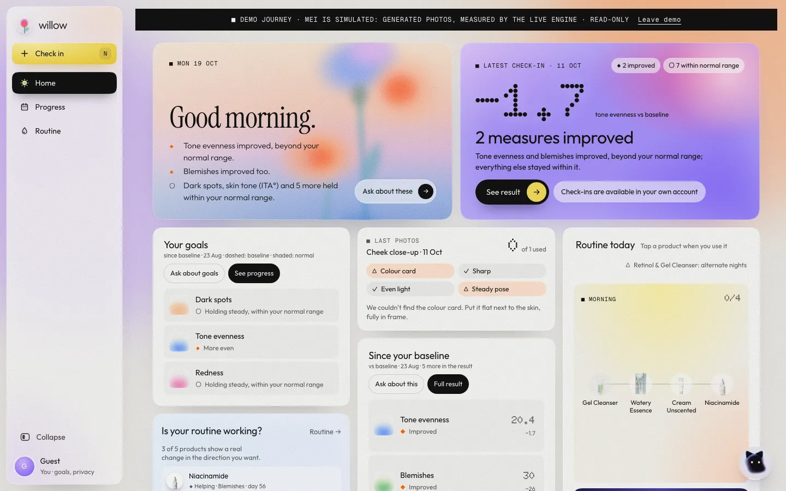
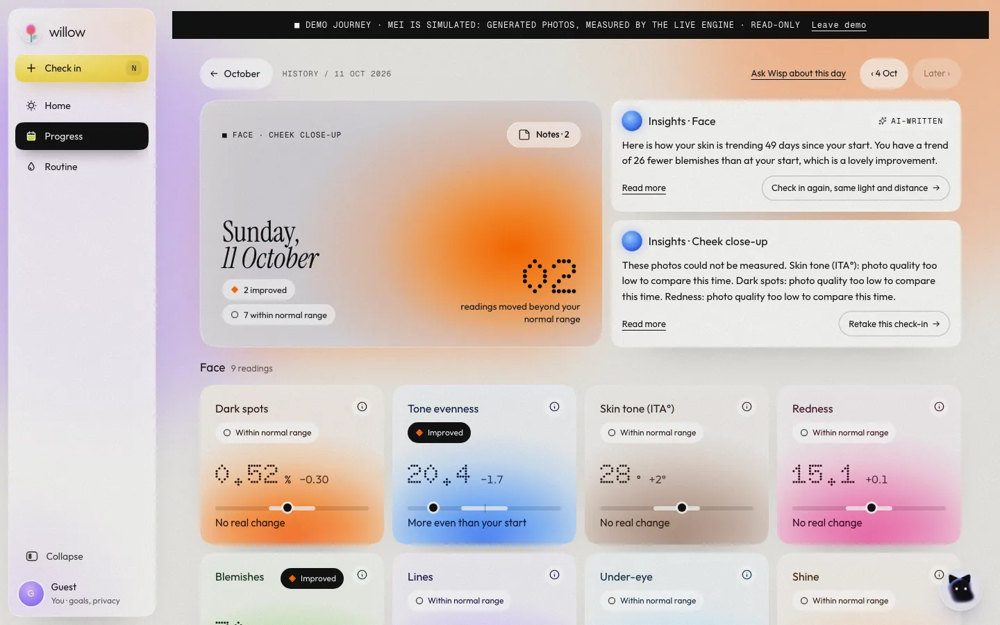
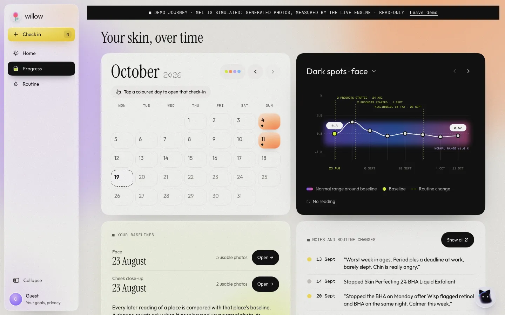
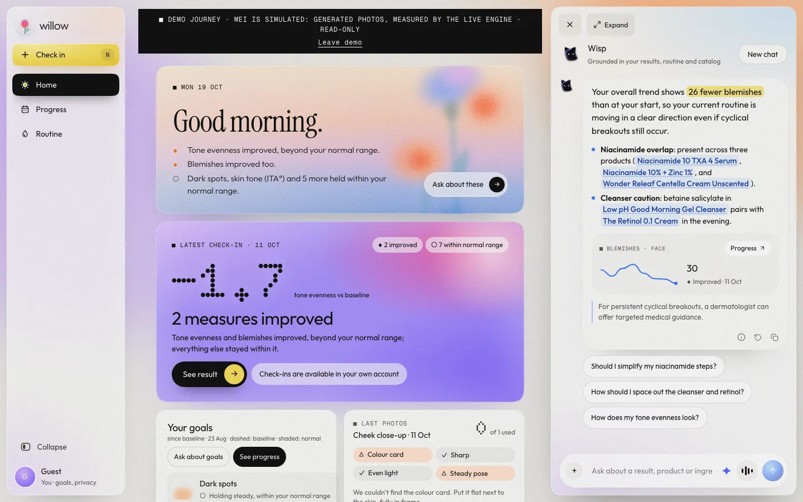
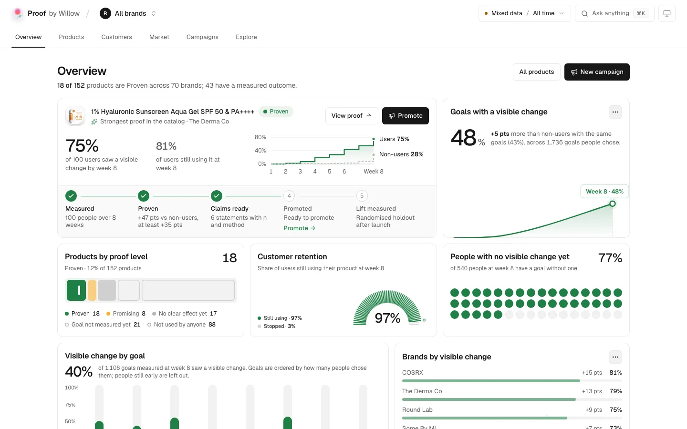
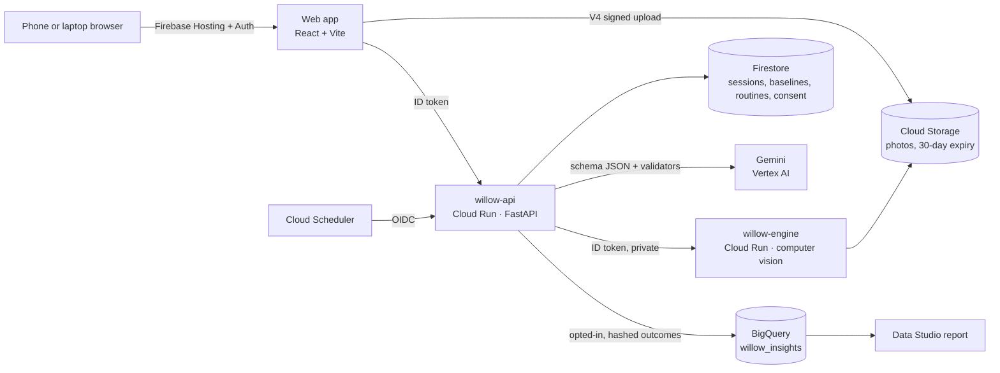

<p align="center">
  
</p>

<h1 align="center">Willow</h1>

<p align="center">
  <b>The proof engine for skincare.</b><br />
  Willow tells a person whether a product <i>measurably</i> changed their skin, beyond the normal noise of their own camera,<br />
  and tells brands and retailers which products produce measured results, for whom.
</p>

<p align="center">
  <a href="https://meetwillow.web.app"></a>
</p>

<p align="center">
  <a href="https://meetwillow.web.app/journey"></a>
  <a href="https://meetwillow.web.app/journey/brand"></a>
  <a href="https://meetwillow.web.app/home?demo=1"></a>
  <a href="https://meetwillow.web.app/retail"></a>
</p>

<p align="center">
  
  
  
  <a href="LICENSE"></a>
</p>

<p align="center">
  Built for the <b>Google Cloud AI Builder Cup 2026</b> · Retail &amp; Commerce: Intelligent Customer and Business Experiences
</p>

<p align="center">
  
</p>

> Cosmetic appearance tracking. Not a medical device and not a diagnosis.

---

## Try it in four minutes

No sign-in needed. Every path runs on the live system: the measurement engine on Cloud Run, Gemini on Vertex AI, Firestore and BigQuery.

| Way in | What you'll see |
|---|---|
| **[Explore Mei's journey](https://meetwillow.web.app/journey)** · *judge experience* | The quickest look. Eight weeks of one person's skincare play by themselves, about a minute of story with the real app shown between weeks. Mei is simulated (see below). |
| **[Explore a brand's journey](https://meetwillow.web.app/journey/brand)** · *judge experience* | How a skincare brand (The Derma Co, from the catalog) uses Proof by Willow: which of its products work, for whom, and every Gemini job in Proof, played for you. |
| **[Open the Willow app](https://meetwillow.web.app/home?demo=1)** · *live app* | Mei's account, read-only: open any check-in, tick her routine, ask Wisp a question of your own. |
| **[Open Proof by Willow](https://meetwillow.web.app/retail)** · *live app* | The business side: products by proof level, customers, market, campaigns, and "Ask anything" over the aggregates. |

The landing page also runs [sample photos through the real pipeline](https://meetwillow.web.app/judge) in a guest account of your own, or starts your own baseline.

**About Mei.** Mei is 26, lives in Singapore and has acne along her cheeks, jaw and chin. Her photos are generated and show no real person, so there is no consent question and nobody's skin is on display. Every number in her story was measured from those photos by Willow's live engine and explained by Gemini, exactly as for anyone. Every surface that shows her says she is simulated.

<p align="center">
  
  <br /><sub>Mei's journey, week 8: two readings clearly improved, three stayed within her normal range. Mei is simulated: her photos are generated and show no real person.</sub>
</p>

---

## The problem

People buy skincare on claims and influencer advice, then can't tell whether it worked.

- **90%** of women are frustrated finding products that work; only **15%** think their wrinkle products work very well (Drive Research, 1,004 women worldwide).
- UK homes hold **over GBP 1 billion** of unused skincare (The Body Shop, n = 2,000); in Hong Kong about **half** of people have stockpiled skincare unused for over a year (Consumer Council).
- **85%** would pay more for beauty products with proven efficacy (Euromonitor, Top Global Consumer Trends 2024).

The missing piece is measurement. Phone photos change with light, angle and the camera's own processing, so "looks better" is mostly noise. And retailers only see purchases and returns, never outcomes. Routines mix brands, so no single brand sees the whole picture; a multi-brand retailer can.

---

## Why you can trust a Willow reading

Three rules run through the whole product. They are what make the numbers worth believing.

**1. Classical computer vision measures every number.** A Python engine (`engine/`) decodes RAW DNG or camera photos, corrects colour when a reference is in frame, finds the face with MediaPipe's 478 landmarks, masks out hair, glare and shadow, and measures 11 cosmetic parameters with documented formulas: skin tone (ITA°), dark spots, tone evenness, redness, blemishes, pores, texture, under-eye, lines, shine and glow. No model is trained, and every reading is marked *measured* or *indicative*. Formulas: [`docs/METRICS.md`](docs/METRICS.md).

**2. Each reading is compared with *your* normal range, not with anyone else.** A place's first check-in is its baseline: five photos, each set up from scratch. Their spread gives a personal noise band, the minimum detectable change at 95%:

```
mdc95 = max( 1.96 · √2 · sd ,  t(0.975, n−1) · sd · √(1 + 1/n) )
```

A later reading counts as a real change only when it leaves that band. Willow then says which way it went: ◆ *Improved*, ◇ *Moved the other way* (never "worse"), or for skin tone only ◆ *Shifted*, because no tone is better than another. Inside the band it says *Within normal range*. Showing "no clear change yet" when that is the truth is the point.

**3. Gemini explains; it never measures.** Gemini never produces a measurement, score, skin tone, skin age or diagnosis. Every Gemini output is structured JSON checked against a schema, and every number it writes must already exist in the data it was given, or the answer is rejected and retried once, then replaced with a fixed template. [`docs/GEMINI_SPEC.md`](docs/GEMINI_SPEC.md) has each job's inputs, schema and validator.

The engine is also built to be fair across skin tones: dark-spot thresholds scale with the person's own skin lightness, and spots and blemishes are found against the person's own skin (a multiple of its own variation above its own regional median), never against an absolute lightness.

---

## The shopper app

A calm web app that installs on a phone. Check in once a week; Willow tells you what clearly changed and what hasn't moved yet.

<p align="center">
  
</p>

**Check-in.** One sheet covers every place you track (face, cheek close-up, and both forearms while a product test runs). The camera guides you with live checks for even light, framing and a steady hold, then each place uploads and is measured in the background. Close-ups use the back camera; RAW DNG files work too.

**Results.** Each day has one page: the readings grouped by place, each with its verdict against your baseline, an AI-written summary of what the numbers mean, and the photo with spots, redness and regions drawn on it (hold to compare with your baseline).

<p align="center">
  
</p>

**Progress.** *Your skin, over time*: one calendar of every check-in, and a chart per metric with your normal range shaded around the baseline and routine changes marked on the timeline, so you can see whether a change lines up with a product.

<p align="center">
  
</p>

**Routine.** Products come from a facts-only catalog of about 150 APAC products, with links to several stores (you choose where to buy; ranking is never sold). The routine check flags clashing actives, duplicates and gaps from a rule table in code; Gemini may add findings, always marked AI-suggested. Daily ticks, a one-tap "how does it feel?" (kept as self-reported, never mixed into measurements), and a **product test**: an arm with the product against an arm without it, which separates a product's effect from light and time of day.

**Wisp, the assistant.** Ask about your results, your routine or a product. Wisp uses Gemini with function calling (`search_catalog`, `compare_products`, `check_routine`), answers first in one sentence, and draws small charts from your own data. Every number and every product it mentions is checked against your readings, your routine or a tool result before you see it, and the steps and checks are shown under each answer.

<p align="center">
  
</p>

---

## Proof by Willow, for brands and retailers

Retailers see sales. Proof shows **outcomes**: which products produce a measured, visible change, for which goals and skin types, and whether people keep using them.

<p align="center">
  
</p>

- **Products by proof level.** *Proven* means at least 30 users measured to week 8 and the lower end of the lift's 95% interval (users against non-users with the same goal) is above zero; *Promising* and *No clear effect yet* follow the same method.
- **The Proof pipeline.** Measured → Proven → Claims ready → Promoted → Lift measured. A brand can promote only a Proven product, only to the goals and skin types its evidence covers, and every campaign keeps a randomised holdout so it reports real incremental lift. Money buys reach, never rank or eligibility, and the shopper always sees "Sponsored".
- **Customers and market.** Goal demand by month, skin-profile splits, retention, brand comparisons with intervals, switching between products, and routine conflicts as an education opportunity.
- **Gemini that helps a brand act.** *Ask anything* answers from the aggregates on screen with a validated chart; *Next steps* picks the most valuable actions from a list the code builds; *Claim drafts* writes pack, product-page and social copy only from measured evidence, and rejects overclaims such as "clinically proven".

**Data.** Opted-in outcomes are exported to BigQuery (`willow_insights`, us-central1) under a one-way hash. Every group under 10 people is hidden, at the api, before any chart or Gemini sees it. A [shareable Data Studio (Looker Studio) report](https://datastudio.google.com/reporting/5147af6b-c268-470a-a420-2277dfcfe7df) reads the same suppressed aggregates. The demo cohort is **synthetic** (`api/app/cohort.py`, fixed seed, assumptions listed on the dashboard) and labelled on every screen.

---

## Gemini: many jobs, never a measurement

Model `gemini-3.8-flash` on Vertex AI. Each job has a schema, a validator and a fallback that is not Gemini.

| Job | Where | How it is kept honest |
|---|---|---|
| Explain a result | Results | Gets the numbers rounded as shown; any other number, a disease name or "lighter is better" wording rejects the answer; fixed template after two failures |
| Metric story | A reading's detail | Code works out every fact; no causes ("caused", "thanks to"), no change claimed without a real change; skin tone is never sent |
| Label the spots the engine found | Result photo | Asked twice in different orders; a label is kept only if both agree confidently; marked AI-suggested; moles carry a "see a dermatologist" note |
| Read a product label | Routine, *Request a product* | Vision to structured JSON with per-ingredient confidence and a failure reason; matched to the catalog |
| Check a routine | Routine | The rule table in code is final; Gemini can only add findings, marked AI-suggested |
| Wisp | Everywhere | Function calling; products only from tool results; every number checked |
| Ask the data | Proof | Sees aggregates only; answer, chart labels and values must exist in them; refuses individual-level questions |
| Brief summary, next steps, claim drafts, AutoCampaign rules | Proof | Gemini picks, words, or reads a rule written in plain words; numbers, tiers and claims come from code; overclaims rejected |

Daily caps per person and across everyone keep cost bounded (`api/app/limits.py`).

---

## Architecture on Google Cloud

Everything runs in **us-central1**, except Gemini, which Vertex AI serves from its global endpoint for Gemini 3.x models.



| Service | What it does in Willow |
|---|---|
| **Firebase Hosting** | Serves the web app at meetwillow.web.app (and willow-511508.web.app) |
| **Firebase Authentication** | Google sign-in, email, and anonymous guest accounts |
| **Cloud Run** ×2 | `willow-api` (FastAPI: sessions, signed uploads, Gemini, catalog, Proof) and `willow-engine` (private: RAW decoding and measurement, called only with an ID token) |
| **Firestore** | Sessions, baselines, routines, consent, campaigns, usage limits. Client rules are deny-all; only the api reads and writes |
| **Cloud Storage** | Photos via V4 signed URLs, deleted after 30 days by a lifecycle rule |
| **Vertex AI (Gemini)** | Every job in the table above |
| **BigQuery** | Outcome tables for Proof and *Ask anything* |
| **Cloud Scheduler** | Check-in reminders (Web Push) |

The engine ↔ api interface is a versioned JSON contract: [`docs/CONTRACT.md`](docs/CONTRACT.md) and [`schemas/`](schemas/).

---

## Privacy and safety

- **Cosmetic language only.** No disease names anywhere in the UI; Willow follows how skin looks, not what a condition is. Moles always carry "not a medical assessment; see a dermatologist for changing moles".
- **No lightness ranking.** Skin tone is descriptive only. "Lighter is better" wording is banned in copy and rejected by the Gemini validators; a tone change only ever reads *Shifted*.
- **Consent first.** Onboarding asks for photo consent before anything is captured. Sharing anonymized outcomes with retailers is a separate opt-in, off unless chosen.
- **Nothing kept that shouldn't be.** Photos live in a private bucket and are deleted after 30 days; nothing is used to train models; *Delete my data* removes everything. Gemini gets crops for labelling and numbers for explanations, never more than the job needs; Wisp declines photos of faces or skin.
- **No real people in the demo.** Mei's photos are generated; the retail cohort is synthetic and labelled.
- **No secrets in the repo.** No images of skin, RAW files, keys or `.env` files are committed; `npm run build` refuses to build if a photo lands in `web/public`. Services use service accounts and Application Default Credentials.

---

## Run it locally

Prerequisites: Python 3.12 with [`uv`](https://docs.astral.sh/uv/), Node 20+, and `gcloud` with Application Default Credentials for the Gemini, Storage and BigQuery features (`gcloud auth application-default login`). Ports: engine 8081, api 8080, web 5173.

**api** (fixture engine, in-memory store so a local run never touches the project's Firestore):

```bash
cd api && uv sync && AUTH_MODE=dev DEV_STORE=memory ENGINE_MODE=fixture uv run uvicorn app.main:app --port 8080
```

**web** (dev sign-in, talks to the local api):

```bash
cd web && npm ci && VITE_AUTH_MODE=dev VITE_DEV_UID=local npm run dev
```

**engine** (optional; the fixture mode above answers from the contract's sample result, labelled as a sample):

```bash
cd engine && uv sync && uv run uvicorn app.main:app --reload --port 8081
```

Tests: `cd engine && uv run pytest`, `cd api && uv run pytest`, `cd web && npm run lint && npm test`. For a full end-to-end run against the real engine, storage, Firestore, Gemini and BigQuery, see [`docs/LOCAL_DEV.md`](docs/LOCAL_DEV.md) and `api/scripts/e2e.py`. Deploying: [`infra/README.md`](infra/README.md).

---

## Repo map

| Path | What |
|---|---|
| [`engine/`](engine/) | Python image pipeline and FastAPI service (Cloud Run) |
| [`api/`](api/) | FastAPI: sessions, uploads, every Gemini feature, catalog, Proof, demo and judge mode (Cloud Run) |
| [`web/`](web/) | React + Vite + TypeScript + Tailwind (Firebase Hosting) |
| [`infra/`](infra/) | GCP and Firebase setup, Firestore rules, deploy commands |
| [`schemas/`](schemas/), [`fixtures/`](fixtures/) | The engine contract (JSON Schema) and a sample result |
| [`docs/`](docs/) | The knowledge base: [product](docs/PRODUCT.md), [decisions](docs/DECISIONS.md), [metrics](docs/METRICS.md), [Gemini](docs/GEMINI_SPEC.md), [retailer insights](docs/RETAILER_INSIGHTS.md), [design](docs/DESIGN.md) and more |

## Honest limits

Willow measures appearance from phone photos. Colour readings on faces and close-ups are relative trends against the person's own baseline, not calibrated colour; RAW photos with a white reference give calibrated forearm readings. Pores and texture need a close-up with enough detail and say so when a photo has too little. Willow cannot assess moles or skin conditions; for a changing mole, see a dermatologist.

## Team

- **Niwin Kumar** — web, api, infra, Gemini features, data and Proof
- **Harshini S** — the measurement engine

## Attribution

Engine: NumPy, SciPy, rawpy / LibRaw, colour-science, scikit-image, OpenCV, MediaPipe Face Landmarker, Pillow, pillow-heif, FastAPI. api: FastAPI, Pydantic, google-genai, Firebase Admin, Google Cloud client libraries, httpx, jsonschema, pywebpush. Web: React, React Router, Vite, Tailwind CSS, Firebase JS SDK, Motion, Lucide, Sonner; fonts Outfit, Instrument Serif, Doto, Geist and Geist Mono. Product images are linked from brand or retailer pages with a credit, never re-hosted.

MIT licence.
